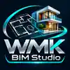

<p align="center"></p>
<h1 align="center">WMK BIM Studio</h1>
<p align="center"><strong>Arquitetura, engenharia e modelagem 2D/3D com automação por agentes</strong></p>
<p align="center"></p>

> **Fork personalizado do [BIMCraft original (IPedrax)](https://github.com/IPedrax/BIMCraft).** A personalização WMK não equivale à conclusão dos recursos do roadmap. Preservamos os direitos autorais e as licenças dos autores originais.

## Sobre o projeto
O **WMK BIM Studio** é um ambiente de modelagem BIM em Rust para criar e editar construções. A base original inclui paredes, pisos, portas, janelas, telhados, níveis, ambientes, cortes, fachadas, pranchas, famílias paramétricas, IFC, recursos de estrutura e instalações e mecanismos de automação por CLI/MCP. A maturidade varia por recurso.

### Diferencial planejado: importar plantas baixas
Queremos permitir que um iniciante forneça **JPG, PNG ou PDF**, ajuste uma escala conhecida e transforme a planta em elementos BIM editáveis. Este fluxo **ainda está em desenvolvimento**. O objetivo tem fases: imagem de referência; calibração; traçado manual; detecção assistida; revisão; geração do modelo BIM 3D. Uma imagem sozinha não garante cotas, altura, materiais, instalações ou estrutura corretos.

## Funcionalidades da base BIMCraft
| Área | Recursos |
|---|---|
| Arquitetura | Paredes, níveis, pisos, telhados, portas, janelas, escadas e ambientes |
| Documentação | Plantas, fachadas, cortes, cotas, quantitativos e pranchas |
| Estrutura | Vigas, pilares, fundações, lajes e armaduras com limitações |
| Instalações | Tubulação, dispositivos elétricos, cabos e modelos MEP |
| Interoperabilidade | IFC, DXF; leitores DWG/RVT sob limitações próprias |
| Automação | Comandos estruturados, CLI e MCP |
| Idiomas | Português já existente no projeto original; tradução completa WMK em revisão |

## Como executar no Windows
Pré-requisitos: Rust 1.95 ou superior, ferramentas de compilação para Windows MSVC e dependências do projeto.
```powershell
git clone https://github.com/WalneyNF/WMK-BIM-STUDIO.git
cd WMK-BIM-STUDIO
cargo run --release -p bimcraft -- --sample
```
> O nome do pacote Cargo continua **bimcraft** para manter compatibilidade durante a personalização. O título da janela e a página inicial WMK são adaptações da interface. Compilação em Windows e release público desta personalização ainda devem ser validados.

## Documentação
- [Manual completo do projeto](manuais/manual-completo.html)
- [Biblioteca de manuais HTML](manuais/index.html)
- [Como usar e instalar](manuais/primeiro-contato.html)
- [Conceitos de arquitetura para leigos](manuais/arquitetura-basica.html)
- [Manual avançado e automação](manuais/avancado.html)
- [Importação de plantas (tutorial)](manuais/importacao-de-plantas.html)
- [Laboratório HTML: JPG, PNG e PDF](tools/planta-baixa/index.html)
- [Identidade visual e personalização](manuais/personalizacao.md)
- [Pesquisas e comparação de concorrentes](pesquisas.html)
- [Pesquisa original do fork WMK](pesquisa.html)
- [Roadmap WMK detalhado e interativo](roadmap.html)
- [Documentação técnica original (inglês)](README.original.en.md)
- [Roadmap técnico original](ROADMAP.md)

## Autoria e licenças
**Logo:** reprodução reduzida da imagem original aprovada, sem redesenho. A imagem em alta resolução e a capa de Facebook estão no pacote complementar de divulgação.

**Personalização WMK:** **Walney Moreira Klein** — **walneyk@hotmail.com**.

**Base original:** [IPedrax/BIMCraft](https://github.com/IPedrax/BIMCraft). Projeto derivado sob as licenças [MIT](LICENSE-MIT) e [Apache-2.0](LICENSE-APACHE), com componentes e dependências sujeitos a avisos adicionais (ver [NOTICE](NOTICE), leitor RVT e ponte DWG). A autoria da base original não é atribuída à WMK.

---
<p align="center">WMK BIM Studio • Aprender, projetar, visualizar e automatizar • © Créditos de personalização Walney Moreira Klein</p>
